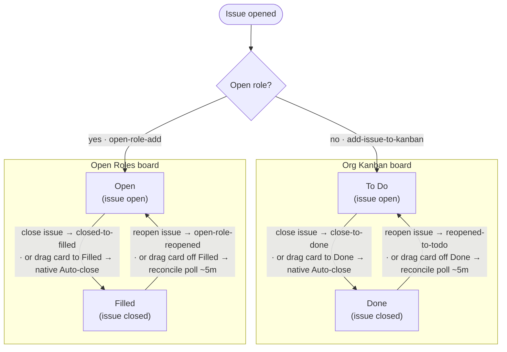

# Open Austin Org Tooling
This repo contains tools, documentation, and automation for managing the [Open Austin](https://www.open-austin.org/) GitHub organization.

**Purpose:** Keep our issue tracker, project boards, labels, and documentation in sync with the org's current structure and priorities.

## Quick Start
### For Contributors
See [CONTRIBUTING.md](CONTRIBUTING.md) for setup instructions (GitHub CLI, auth, spike workflow).

### For Agents
See [AGENTS.md](AGENTS.md) or [CLAUDE.md](CLAUDE.md) for rules, boundaries, and write safety requirements.

## Reading Org State
This repo does not ship a sync tool. It had one until 2026-09-07; `tools/sync/` was removed because it existed to feed one maintainer's private knowledge system and had no other users. Read current org state through the GitHub UI, or `gh` directly:

```bash
gh issue list --limit 200 --state open --json number,title,labels,assignees
gh project item-list 9 --owner open-austin --format json   # Org Kanban
gh project item-list 6 --owner open-austin --format json   # Open Roles
```

`snapshot/` remains gitignored scratch space that `tools/notify/` reads from. Nothing here regenerates it from GitHub any more. See `docs/archive/retire-sync-tooling.md`.

## Write Operations
Guarded writes happen through the **board-automation workflows** described below, the repo's narrow dry-run-first tools, and the **`gh` CLI** for ad-hoc changes that do not yet justify a wrapper. Use `gh issue create` for issue creation and Agent Hands `use-google-docs` for bounded shared-Doc reads and exact-match replacements. See [AGENTS.md](AGENTS.md) for the approval and write-safety rules.

All write operations follow the write-safety rules: dry-run first where supported, and explicit approval before anything that mutates shared org state.

### Issue Creation
```bash
gh issue create --repo open-austin/org --title "Task title" --body-file /tmp/issue.md --label infrastructure --assignee @me
```

The wrapper that used to front this (`tools/issues/create.sh`, dry-run by default) was removed 2026-09-07 along with the rest of the single-maintainer tooling — see `docs/archive/retire-sync-tooling.md`. `gh` does the work; the approval discipline it enforced is stated in [AGENTS.md](AGENTS.md) and is a rule rather than a script. **Confirm the exact title, body, labels, and assignees with a human before creating an issue.**

### Shared Google Docs
Use [Agent Hands](https://github.com/jcklpe/agent-hands)' [setup-google-services](https://github.com/jcklpe/agent-hands/blob/main/setup-google-services/SKILL.md) and [use-google-docs](https://github.com/jcklpe/agent-hands/blob/main/use-google-docs/SKILL.md). Org no longer carries a second Docs client or OAuth implementation. Keep the two skills together in an Agent Hands checkout or a supported installation. Follow their runtime prerequisites; Org's organization rules still govern target selection, authorship and approval.

Select an existing Google account alias and keep its credentials and token in Agent Hands' private provider configuration. Reuse existing credential/token paths rather than copying secrets into Org or creating a second token. Installation does not grant account access or permission to edit a document. Do not reauthorize merely to test this cutover; request missing access only for an actual authorized operation.

Set `AGENT_HANDS_ROOT` to the installed checkout root, `OPEN_AUSTIN_GOOGLE_ALIAS` to the selected alias, and `OPEN_AUSTIN_WEEKLY_NOTES_DOC_ID` to the target supplied at runtime. The placeholders are in `.env.example`; export the selected values in your shell. These commands do not automatically load Org's `.env`.

```bash
bash "$AGENT_HANDS_ROOT/use-google-docs/scripts/docs" --help
bash "$AGENT_HANDS_ROOT/use-google-docs/scripts/docs" read "$OPEN_AUSTIN_GOOGLE_ALIAS" "$OPEN_AUSTIN_WEEKLY_NOTES_DOC_ID" --show-links
bash "$AGENT_HANDS_ROOT/use-google-docs/scripts/docs" replace-once "$OPEN_AUSTIN_GOOGLE_ALIAS" "$OPEN_AUSTIN_WEEKLY_NOTES_DOC_ID" --old-file /tmp/current.txt --new-file /tmp/replacement.txt
bash "$AGENT_HANDS_ROOT/use-google-docs/scripts/docs" replace-once "$OPEN_AUSTIN_GOOGLE_ALIAS" "$OPEN_AUSTIN_WEEKLY_NOTES_DOC_ID" --old-file /tmp/current.txt --new-file /tmp/replacement.txt --link "Visible issue label=https://github.com/open-austin/org/issues/123"
```

Replacement previews by default, requires exactly one match, re-fetches before execution, and uses a required revision ID. Add `--execute` only for the approved exact change, then independently re-read the affected section. Optional `--tab-id` limits the target. Use small corrections, action-state changes and issue cross-links; do not insert parallel agent minutes or substitute a whole-body rewrite. The Open Austin procedure remains [process-weekly-meeting](skills/process-weekly-meeting/SKILL.md).

## Weekly Organizing Meeting
Follow [skills/process-weekly-meeting/SKILL.md](skills/process-weekly-meeting/SKILL.md) when reconciling the recurring weekly organizing meeting. `General Organizing - meeting notes` remains canonical. The workflow audits chatbot-produced beat-by-beat notes and analysis against the matching dated section and fresh GitHub state, then produces an exact approval slate before any shared Doc or public issue changes.

## Board Automation
GitHub Actions in [`.github/workflows/`](.github/workflows/) keep issue state and the two project boards (Org Kanban, Open Roles) in sync, so closing/reopening an issue and moving a board card stay consistent without manual bookkeeping. **Almost everything is custom Actions in this repo** — with exactly **one deliberate exception**: the native Projects "Auto-close issue" workflow (see below). All other native Projects workflows are intentionally turned **off**, so code is the single source of truth.

A tracked issue has one continuous lifecycle: it's **opened**, routed once (by whether it carries the `open role` label) to one board, and then cycles between an open state and a closed state on that board. Each cycle transition can be driven from **either side** — act on the issue, or move the card — and they stay in sync.



Everything on the issue side (open / close / reopen) and the native card→close is **immediate**. The one lagging path is **card → reopen** (dragging a card out of Done/Filled): it's the single scheduled job (`board-reopen-reconcile`), and **GitHub's scheduled runs are best-effort, often delayed 10–30+ minutes** (the first run after enabling is slowest) — so reopening the *issue* directly is the instant option. That reconciler is the one exception to "immediate"; the one exception to "in the repo" is the native `Auto-close issue` workflow (card→close), which is configured in the Projects UI and has no workflow file. A fresh-close guard keeps the reconciler from resurrecting issues closed before this automation existed (it skips anything closed in the last 10 minutes; a one-time cleanup tool used during rollout confirmed the boards were already consistent and has since been removed).

**Routing is right-the-first-time — no board is wastefully double-touched.** An open-role issue created via the form goes straight to Open Roles and never lands on the Kanban. The *only* time anything is removed from a board is **reclassification**: a plain issue that landed on the Kanban is *later* labeled `open role`, so `open-role-add` moves it to Open Roles and clears the now-stale Kanban card. Separately, `label-open-role-from-form` reads the open-role form's team dropdown and applies the team label(s).

**Scheduled maintenance & reporting** (separate from the sync loop above):

| Workflow | Cadence | Purpose |
|---|---|---|
| `archive-old-done` | weekly | Archive Org Kanban `Done` items older than 180 days |
| `archive-old-filled` | weekly | Archive Open Roles `Filled` items older than 1 year |
| `stale-role-warning` | weekly | Comment on open roles with no update in 90+ days |
| `role-pipeline-report` | monthly (1st Monday) | Post the Open Roles pipeline snapshot to `#t-engagement` |

The per-team [`weekly-org-summary`](skills/weekly-org-summary/SKILL.md) is retired and retained as a historical reimplementation record. It is not an active scheduled service. The monthly role report above posts directly from its workflow; it does not call `tools/notify/`.

## Documentation
- **Active spikes:** `docs/active-spikes/` — current work with accompanying `.todo.md` files
- **Policies:** `docs/policies/` — current rules, defaults, procedures, and useful rationale
- **Saved for later:** individual `docs/scratch/` subject notes — possibilities or parked questions, without a commitment to start work
- **Misc intake:** `docs/scratch/misc.md` — raw observed friction and issue intake
- **Scratch:** `docs/scratch/` — exploratory drafts
- **Archive:** `docs/archive/` — historical context

See [project-workflows/run-project-spike/SKILL.md](project-workflows/run-project-spike/SKILL.md) for the full workflow, and [skills/](skills/) for the repo's other agent-assisted workflows.

## Project Workflows adoption
Use the adopted [contribution procedure](project-workflows/coordinate-project-contribution/SKILL.md) and [collaborator quick start](project-workflows/README.md#join-an-existing-project) for human-directed review across separate agent-owned spikes. A branch may carry several spikes/issues and later PRs; Commit Work retains atomic scope. Existing governance, canonical shared records and explicit external-write approval rules remain authoritative. This update enables no new forge automation.

The complete collection lives in `project-workflows/` on `project/org`; the parent pins its exact commit. Use its [update procedure](project-workflows/update-project-workflows/SKILL.md) for reconciliation, with project rules in [AGENTS.md](AGENTS.md). After the required commit is published, initialize a fresh clone with `git submodule update --init project-workflows`. This adoption is local only pending security/privacy review: the recorded public URL does not yet make the new pin available to collaborators. [Reconciliation and validation](docs/active-spikes/project-workflows-adoption.md) · [remaining steps](docs/active-spikes/project-workflows-adoption.todo.md).
